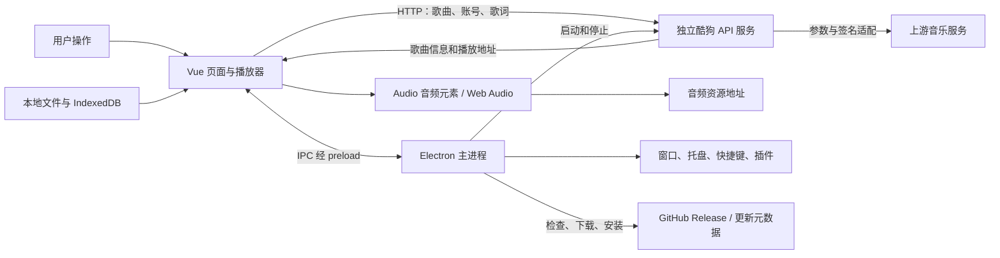

# MoeKoeMusic 项目逻辑导读

阅读顺序建议：先读本文的整体架构和启动、播放流程，再按需要查看 [逐文件与函数索引](D:/Project/MoeKoeMusic/docs/PROJECT_FILE_REFERENCE.md)，最后阅读 [自动更新审查文档](D:/Project/MoeKoeMusic/docs/AUTO_UPDATE_REVIEW.md)。

这份说明基于当前本地工作区：主项目 `1.7.0`，API 子模块固定提交 `a5a98013cce79fe0ae2ad65fc84b68176ebcfc1e`，包含上一轮尚未提交的自动更新改动。本文会明确标注这些改动。本轮只新增理解项目所需的文档，不继续修改业务代码。

## 1. 先理解程序实际由什么组成

这不是一个把所有功能都放在 Electron 中的程序。它由界面、桌面外壳、音乐接口服务三部分组成，界面还可以独立部署为网页。

| 部分 | 运行在哪里 | 主要职责 | 入口 |
| --- | --- | --- | --- |
| Vue 界面 | 浏览器或 Electron 的 Chromium 渲染进程 | 页面、登录、歌曲队列、音频播放、歌词、本地文件浏览 | `index.html` → `src/main.js` → `src/App.vue` |
| Electron 桌面外壳 | Electron 主进程 | 窗口、托盘、快捷键、API 子进程、插件、安装更新 | `electron/main.js` |
| preload 桥接层 | Electron 的窗口预加载环境 | 把受控的主进程调用暴露给界面 | `electron/preload.cjs` |
| 酷狗 API 服务 | 独立 Node 服务或打包的子进程 | 把前端 API 请求转换为上游音乐服务请求 | `api/app.js` → `api/server.js` |

**真正播放音频的是渲染进程里的 `new Audio()`，不是 API 服务，也不是 Electron 主进程。** API 返回播放地址后，Chromium 的音频元素去读取音频资源。



`IPC` 可以理解为界面向桌面外壳发消息。`HTTP` 则是界面向音乐 API 服务发请求。这两种通信承担不同职责。

## 2. 所有主要文件夹的作用

```text
MoeKoeMusic/
├── src/                  Vue 界面与播放器源代码
│   ├── views/            路由对应的完整页面
│   ├── layouts/          页面共用的导航、内容区、播放器布局
│   ├── components/       可复用组件及播放器功能模块
│   │   ├── player/       音频、歌词、队列、进度等逻辑
│   │   │   └── songQueue/ 在线、云盘、本地三种歌曲来源
│   │   ├── discover/     发现页面的榜单、新歌、新专辑、歌单内容
│   │   ├── search/       搜索结果的各类展示组件
│   │   └── home/         首页推荐卡片
│   ├── stores/           Pinia 共享状态
│   ├── utils/            HTTP、风控、地址、主题、分享等辅助逻辑
│   ├── composables/      生命周期观察和吸顶等可复用 Vue 逻辑
│   ├── config/           设置项、免责声明、引导的声明数据
│   ├── plugins/          Vue 弹窗/通知插件，不是 Chrome 扩展
│   ├── router/           页面路由与登录守卫
│   ├── language/         六种语言的界面文案
│   └── assets/           被 Vite 引用处理的样式和图片
├── electron/             桌面外壳代码
│   ├── services/         更新、日志、托盘、歌词等桌面服务
│   ├── extensions/       Chrome 扩展和扩展本地程序管理
│   ├── language/         原生菜单/对话框的多语言文案
│   └── view/             自定义托盘菜单 HTML
├── api/                  独立 Git 子模块，音乐 API 服务
│   ├── module/           一个文件对应一个公开 API 路由
│   ├── util/             HTTP、签名、加解密、缓存、设备信息等
│   ├── public/           API 的调试、验证示例页和 WASM 资源
│   ├── docs/             API 接口文档站
│   └── .github/          API 子仓库自身的构建流程
├── public/               前端直接复制的静态文件
│   └── assets/           字体、图标、音频、图片等
├── build/                安装器与桌面程序打包资源
│   └── icons/            桌面、托盘、菜单、节日等图标
├── images/               README/宣传文档使用的截图与图片
├── plugins/extensions/   开发环境的 Chrome 扩展目录
├── .github/              主项目的发布流程、Issue/PR 模板与治理
├── docs/                 多语言 README 与本轮新增分析文档
└── tests/                上一轮新增的更新控制器与界面测试
```

`src/plugins/` 是 Vue 插件；`plugins/extensions/` 是桌面 Chrome 扩展，二者不是同一套机制。`electron/services/apiService.js` 是外部播放控制 WebSocket 服务，也不是 `api/` 音乐 HTTP 服务。

`node_modules/` 是安装的第三方依赖，`dist/` 是前端生成产物，`dist_electron/` 是桌面安装包产物，`.git/` 是版本管理元数据。它们不是需要逐行维护的项目业务源代码。逐文件索引覆盖主项目文件和 API 子模块文件，不把这些生成目录当成业务源码列入。

## 3. 桌面版如何启动

按 [electron/main.js](D:/Project/MoeKoeMusic/electron/main.js) 的实际执行顺序：

1. 导入桌面服务，创建 `electron-store`，准备 `mainWindow` 等主进程状态。
2. 请求单实例锁。同一程序第二次启动时，把窗口显示出来，并把 `moekoe://` 参数交给协议处理器。
3. 在 ready 之前应用需要早期设置的硬件加速、DPI、防休眠等配置；开启 API 模式时准备外部控制服务。
4. Electron 发出 `ready`。
5. **上一轮改动：先初始化更新器，避免音乐 API 故障阻止更新。**
6. `startApiServer()` 启动音乐 HTTP API。开发环境直接 resolve，需要开发者自己启动 API；安装版启动平台对应的 API 可执行文件。
7. 子进程输出包含 `running` 时，主进程把 API 视为已启动。
8. 创建主窗口、托盘、自定义托盘菜单、状态栏歌词、快捷键、协议处理和插件。
9. 主窗口加载界面。开发环境使用 `http://localhost:8080`；普通安装版使用打包后的 `dist/index.html`；测试网/开发网设置可改变界面地址。
10. `did-finish-load` 发送应用版本和必要的免责声明提示。

API 子进程的位置由 [appServices.js](D:/Project/MoeKoeMusic/electron/appServices.js) 按平台决定：

| 平台 | API 文件 | 常用启动参数 |
| --- | --- | --- |
| Windows | 安装目录中的 `api/app_win.exe` | `--platform=lite --port=6521`，按设置增加 `--proxy=` |
| macOS | 应用包中的 `api/app_macos` | 同上 |
| Linux | 安装目录中的 `api/app_linux` | 同上 |

`dataSource = concept` 时传入 lite 参数。其他数据源不会走这个分支。API 地址在界面中可自定义，所以“主进程启动的本地 API”与“界面实际访问的 API”也可能不相同。

原来 API 启动失败后提示退出；**上一轮改动增加原生“检查更新”入口**。这是恢复应用的入口，并不能自动诊断为什么 API 启动失败。

## 4. Vue 界面如何启动与组织

[src/main.js](D:/Project/MoeKoeMusic/src/main.js) 创建 Vue 应用，注册 Pinia、路由、多语言、全局弹窗和消息通知，最后挂载到 HTML 的 `#app`。

几个核心概念：

| 写法 | 含义 | 在本项目中的例子 |
| --- | --- | --- |
| `ref()` / `reactive()` | 页面运行中的响应式状态 | 正在播放的歌曲、登录表单、列表结果 |
| `computed()` | 随状态变化得到的派生值 | 播放进度、按钮文案、过滤列表 |
| `watch()` | 状态变化后执行操作 | 歌曲 hash 改变后加载歌词/封面 |
| `props` | 父组件向子组件传数据 | 页面收到 `playerControl` |
| `emit()` | 子组件把动作交给父组件 | 搜索结果点击歌曲 |
| `defineExpose()` | 允许父组件通过 ref 调用方法 | `PlayerControl` 暴露添加队列、播放等方法 |
| `onMounted` / `onUnmounted` | 创建后初始化、销毁时清理 | 注册/解绑事件，清理媒体资源 |
| `KeepAlive` | 切换页面后保留组件状态 | 首页、发现、搜索等缓存页面 |

[App.vue](D:/Project/MoeKoeMusic/src/App.vue) 提供全局标题栏、路由内容、免责声明和 macOS 状态栏歌词渲染；同时初始化设备信息。桌面歌词路由不展示普通主窗口这些外层组件。

[HomeLayout.vue](D:/Project/MoeKoeMusic/src/layouts/HomeLayout.vue) 提供顶部或侧边导航、路由内容区、常驻播放器和新手引导。它还管理页面缓存、滚动位置、布局切换和网络状态。

因此，从首页切到搜索时，`PlayerControl` 通常仍留在布局中，音频不用因为页面切换重新创建。完整路由跳到独立 `/video`、`/lyrics` 页面时，组件树则不同。

## 5. 每个页面做什么

路由定义见 [router.js](D:/Project/MoeKoeMusic/src/router/router.js)。使用 Hash 路由，如 `/#/search`，适合 Electron 加载本地 HTML。

| 路由 | 页面文件 | 工作内容 |
| --- | --- | --- |
| `/`、`/share` | `Home.vue` | 每日推荐、推荐歌单；解析分享歌曲/歌单参数；调用播放器 |
| `/discover` | `Discover.vue` | 管理歌单、新歌、新专辑和排行榜四类发现内容 |
| `/library` | `Library.vue` | 用户资料、VIP 信息、听歌情况、关注、歌单与活动 |
| `/login` | `Login.vue` | 账号密码、短信、二维码登录；把登录结果写入认证 Store |
| `/settings` | `Settings.vue` | 主题、字体、音质、音频设备、快捷键、网络/API、插件、引导等设置 |
| `/playlistDetail` | `PlaylistDetail.vue` | 同一个页面承载歌单、专辑、歌手歌曲列表；分页、收藏、批量操作 |
| `/search` | `Search.vue` | 综合、歌曲、专辑、歌单、歌手、MV 等搜索及分页 |
| `/search/recommend` | `RecommendedSearch.vue` | 热搜榜与输入建议；选择词条后进入搜索 |
| `/ranking` | `Ranking.vue` | 独立榜单入口，内容复用 `RankingContent.vue` |
| `/CloudDrive` | `CloudDrive.vue` | 云盘列表、音频上传、删除、排序、批量播放 |
| `/LocalMusic` | `LocalMusic.vue` | 本地目录授权、扫描、元数据/封面缓存、排序与播放 |
| `/recognize` | `Recognize.vue` | 麦克风或系统音频采集、识别歌曲、播放或收藏结果 |
| `/lyrics` | `Lyrics.vue` | 桌面歌词独立窗口；拖动、锁定、鼠标穿透、字号和颜色 |
| `/video` | `VideoPlayer.vue` | 获取视频地址并播放 MV；独立窗口/网页弹窗共用 |

代码显式要求登录的路由是 Library、Search 和 RecommendedSearch。其他页面是否能取得具体数据还受对应 API 的登录、权限和版权判断影响，不能只看路由有没有 `requiresAuth`。

## 6. 登录、设备信息和请求链路

### 6.1 账号数据

[stores/store.js](D:/Project/MoeKoeMusic/src/stores/store.js) 定义 `MoeAuthStore`，包括：

- `UserInfo`：登录得到的用户和 token 等信息。
- `Device`：注册设备得到的 dfid、mid、guid 等信息。
- `Config`：保存的配置数据及 `fetchConfig()` 读取入口。
- `isAuthenticated`：当前代码根据有没有 `UserInfo` 判断登录状态，并不是实时向服务端验证 token。

`initDevice()` 使用独立 axios 实例请求 `/register/dev`，避免认证 Store 与普通 HTTP 拦截器相互引用形成循环。登录流程成功后通过 `setData()` 写入 Store，并按路由返回目标页面。

### 6.2 前端请求层

[utils/request.js](D:/Project/MoeKoeMusic/src/utils/request.js) 创建 axios 实例。地址来自 [apiBaseUrl.js](D:/Project/MoeKoeMusic/src/utils/apiBaseUrl.js)：环境变量 `VITE_APP_API_URL`、设置中的自定义地址或默认 `http://127.0.0.1:6521`。

```text
页面调用 get('/song/url', { hash })
  → request.js 获取账号和设备信息
  → 写入 Authorization（token、userid、dfid、mid 等）
  → axios 发送给 API 服务
  → API 响应经过风险验证处理
  → 成功后返回 response.data 给页面
```

所以页面里的 `response.status` 很多时候是酷狗业务状态，例如 `1` 表示成功，而不是 HTTP `200`。错误还可能带着 `error.response`，需要分清 HTTP 层与业务层。

### 6.3 API 子模块做什么

[api/server.js](D:/Project/MoeKoeMusic/api/server.js) 扫描 `api/module/*.js`，将文件名中的下划线变成 `/`。例如：

```text
module/song_url.js        → /song/url
module/user_playlist.js   → /user/playlist
module/register_dev.js    → /register/dev
```

每个模块通常导出 `(params, useAxios) => ...`。它把前端参数转换成酷狗接口要求的参数，然后调用统一请求函数。这个名称 `useAxios` 实际指主服务传入的请求适配函数，不一定只是裸 axios。

```text
server.js：解析 Cookie、Authorization、query、body
  → module/song_url.js：组织播放地址请求
  → util/request.js：补设备参数、客户端版本、签名、代理等
  → 酷狗上游接口
  → 模块/服务器处理状态、响应体、Cookie
  → 返回 Vue 页面
```

`server.js` 还负责 CORS、静态页面、请求体大小限制和两分钟成功响应缓存。上游请求默认走酷狗网关，部分模块指定独立域名。

`api/main.js` 是另一种入口：把模块导出成可直接调用的 Node 函数库。桌面应用默认启动的是 `api/app.js` HTTP 服务，而不是通过它直接调用函数。

### 6.4 风控验证

`request.js` 的响应拦截器把需要验证的响应交给 `riskVerify.js`，后者根据错误码/ssa 标识决定是否展示 `RiskVerifyModal.vue`。验证任务被串行排队，防止多个接口同时弹出验证界面。

完成验证后最多重试一次原请求；仍失败则返回错误。验证 API、设备信息、上游风控参数属于接口兼容性逻辑，和应用自动更新是不同链路。

## 7. 从点击歌曲到真正播放

这是理解项目最重要的一条路径。

### 7.1 页面如何接入播放器

`HomeLayout` 通过 ref 保留 `PlayerControl`，再把它传给路由页面。页面整理歌曲数据后调用它暴露的队列方法；列表组件常先 emit 给页面，再由页面调用播放器。

[PlayerControl.vue](D:/Project/MoeKoeMusic/src/components/PlayerControl.vue) 是播放器的协调中心。它把音频、歌词、模式、队列、媒体会话等模块组合起来，同时实现播放栏和全屏歌词 UI。它不是单纯的“底部按钮组件”。

### 7.2 三种歌曲来源

| 来源 | 模块 | 如何取得可播放资源 |
| --- | --- | --- |
| 在线歌曲 | `OnlineMusicQueue.js` | 根据 hash 查询权限/音质，再通过 `/song/url` 获取音频 URL |
| 云盘歌曲 | `CloudMusicQueue.js` | 通过 `/user/cloud/url` 获取用户云盘资源地址 |
| 本地歌曲 | `LocalMusicQueue.js` | 从 File/文件句柄取得 Blob，生成当前运行期的 `blob:` URL |

`SongQueue.js` 把三种来源组合成统一入口。`stores/musicQueue.js` 保存队列数组；当前歌曲、优先下一首、歌词、Audio 对象还分布在播放器模块中，并不是所有播放状态都集中在 Pinia。

### 7.3 在线播放具体步骤

1. 根据 hash 建立一次新的歌曲请求，并递增请求编号。
2. 未登录时请求试听/免费片段；登录时按设置音质查询 `/privilege/lite`。
3. 组织所选音质到较低音质的候选链，逐个请求 `/song/url`。
4. 过滤没有 URL、失败或不合适格式的响应。
5. 检查这次请求是否已过期。用户快速切歌时，旧请求结果不能覆盖新歌曲。
6. 整理成统一歌曲对象，包括 hash、名称、作者、封面、播放 URL、音质和响度信息。
7. 加入/更新队列，然后把歌曲交给 `playSong()`。
8. `playSong()` 更新当前歌曲、重置进度、设置 `audio.src` 和播放速度，调用 `audio.play()`。
9. 成功后更新标题、系统媒体信息、持久化的当前歌曲，并按需加载歌词和高潮点。
10. 获取失败时，部分分支返回 `shouldPlayNext`，由协调中心延迟切换下一首。

注意：队列中的 hash 是识别歌曲的依据，URL 是播放资源位置，两者不是同一个东西。音频 URL 可能过期，因此“本地保存的队列存在”不保证下一次启动还能直接播放保存的 URL。

### 7.4 音频模块分工

| 模块 | 核心职责 |
| --- | --- |
| `AudioController.js` | 创建 Audio；播放/暂停、音量、静音、速度；可选 Web Audio 增益和响度规格化 |
| `AudioOutput.js` | 调用 `setSinkId` 选择音频输出设备；判断浏览器是否支持 |
| `PlaybackMode.js` | 随机、列表循环、单曲循环、顺序播放；保存所选模式 |
| `ProgressBar.js` | 拖动/点击 seek、时间提示、高潮点加载 |
| `ClimaxPoints.js` | 归一化高潮点数据、缓存和请求失效控制 |
| `MediaSession.js` | 给操作系统媒体面板提供歌曲信息、播放位置及控制回调 |
| `Helpers.js` | 键盘、音量滚轮、桌面歌词开关等共用逻辑；也包含概念版 VIP 活动请求 |

浏览器播放策略、音频格式、跨域响应、音频设备权限都会影响 `audio.play()`。这些条件不应和“版本检查失败”混为一谈。

## 8. 歌词为什么有多个组件

项目有三种歌词表现形式：主窗口全屏歌词、独立桌面歌词、macOS 菜单栏歌词。

### 8.1 主窗口歌词

`LyricsHandler.js` 先调用 `/search/lyric` 找候选，再调用 `/lyric` 下载解码后的 KRC。API 侧 `decodeLyrics()` 处理 KRC 解码，前端继续解析行时间、字时间、翻译/音译信息。

`PlayerControl` 按 Audio 当前时间更新高亮、滚动和背景，`FullscreenLyricsSettings.vue` 提供全屏歌词显示选项。

### 8.2 桌面歌词

```text
PlayerControl 的当前歌词和播放时间
  → preload：lyrics-data / play-pause-action
  → main.js 转发
  → 独立 BrowserWindow 加载 /lyrics
  → Lyrics.vue 渲染和高亮
```

反方向，歌词窗口的拖动、锁定和播放按钮通过 IPC 交给主进程，主进程再改变窗口或通知主播放器。鼠标穿透必须由 Electron 完成，普通 Vue DOM 无法直接控制桌面窗口穿透。

### 8.3 macOS 状态栏歌词

`statusBarLyricsService.js` 把文字渲染任务交给 `StatusBarLyrics.vue`。后者在 Canvas 中绘制图片并处理长文本滚动，再发送 `update-statusbar-image`。主进程把图片设置到托盘/状态栏。

## 9. 本地音乐与云盘的区别

### 9.1 本地音乐

`LocalMusic.vue` 使用 File System Access API 选择目录、递归扫描音频、读取元数据和封面。它把目录句柄、历史目录、歌曲缓存放进 `LocalMusicDB`，主要对象仓库是 `folderHandles` 与 `musicTracks`。

`music-metadata` 读取标签、时长、编码等信息；展示大量歌曲时用虚拟列表，避免一次创建所有行。

播放端 `LocalMusicQueue` 根据 File 或持久化的文件句柄恢复可读文件。权限丢失时可能需要重新授权。`blob:` URL 只在当前运行期有效，不能靠保存字符串跨启动恢复，代码会重建资源和封面。

### 9.2 云盘

`CloudDrive.vue` 操作远程 `/user/cloud` 接口。上传包含读音频信息、构造文件数据、调用上传 API；API 的 `user_cloud_upload.js` 再协调上游授权、分片初始化、分片上传、完成及登记。

这是用户账号的远程音乐云盘，与本地目录缓存、自动更新安装包缓存都不同。

## 10. 听歌识曲与视频

`Recognize.vue` 获取麦克风设备或系统音频捕获流，录制片段、解码成 PCM，再交给 `utils/recognize.js`。后者 POST 二进制到 `/audio/match`，把识别结果归一化为可播放歌曲并按置信度排序。

`VideoPlayer.vue` 从路由中拿视频 hash，通过 `/video/url` 取得地址，然后使用视频元素播放。`openMvPlayer()` 在桌面调用主进程打开独立窗口，在网页尝试弹窗，弹窗不可用时回到路由。

## 11. 设置与数据保存

本项目没有一个覆盖全部模块的统一设置数据库，主要有四类状态位置。

| 保存位置 | 主要内容 | 使用者 |
| --- | --- | --- |
| `localStorage` | 界面设置、当前歌曲、播放进度/速度/音量、布局、歌词选项等 | Vue 页面与播放器 |
| Pinia + 持久化插件 | 账号/设备信息、队列 | Store 与引用 Store 的页面 |
| IndexedDB | 本地目录和文件句柄、歌曲缓存、封面 Blob | 本地音乐页面和队列 |
| `electron-store` | 主进程设置、窗口位置、免责声明、扩展本地程序授权等 | Electron 服务 |

[config/settings.js](D:/Project/MoeKoeMusic/src/config/settings.js) 定义设置项的标签、选项、默认值、可用环境和动作名称。[Settings.vue](D:/Project/MoeKoeMusic/src/views/Settings.vue) 展示并执行这些动作。

```text
用户改变设置
  → Settings.vue 整理为 key/value
  → localStorage 保存
  → settings-change 或专项 CustomEvent 通知界面模块
  → 桌面环境额外发 save-settings IPC
  → main.js 写入 electron-store
```

主题和输出设备等可即时生效；API 进程参数、窗口样式、硬件设置等往往依赖重载或重启。不要假定每个设置修改后都会同时在所有进程里生效。

`Config`、界面 `settings`、主进程 `settings` 虽然名字接近，保存位置和读取方式并不完全相同。

## 12. 桌面通信与系统集成

### 12.1 preload

[preload.cjs](D:/Project/MoeKoeMusic/electron/preload.cjs) 暴露两组对象：

- `window.electron`：通用 IPC send/invoke/on/解绑接口，以及平台信息。
- `window.electronAPI`：插件管理、日志、视频窗口和更新等具体调用。

`send` 对应主进程的事件监听，`invoke` 对应 `ipcMain.handle`，可以拿到返回值。`on` 用于订阅主进程主动发送的消息。

### 12.2 主要功能链路

| 功能 | 界面/系统 → 主进程 | 主进程 → 界面/系统 |
| --- | --- | --- |
| 自定义标题栏 | `window-control` | 最小化、最大化、关闭或托盘隐藏 |
| 设置 | `save-settings`、`custom-shortcut` | 写设置、重新注册系统快捷键 |
| 托盘控制 | 原生菜单或自定义菜单动作 | `play-next-track`、`toggle-play-pause` 等 |
| 歌词 | `lyrics-data`、窗口控制 IPC | 转发歌词、改窗口位置/穿透状态 |
| 分享链接 | 系统传入 `moekoe://` | 解析 hash/listid/组队码并送给播放器 |
| 更新（上一轮修改） | `start-update-download`、`install-update` | `update-state`、任务栏进度、原生提示 |
| 外部控制 | WebSocket 6520 的消息 | 控制播放器并广播歌词/播放状态 |

`apiService.js` 的 WebSocket 端口是 **6520**；音乐 HTTP API 常用 **6521**；Vite/网页入口常用 **8080**。它们不能互换。

`externalLinkHandler.js` 在窗口导航/新窗口事件中判断外链，把外链交给系统浏览器。它与 `open-url` IPC 一起构成网页到外部浏览器的跳转路径。

## 13. 插件系统如何工作

插件机制只存在于桌面环境。完整链路包括管理页、IPC、Chrome 扩展会话，以及可选本地程序。

```text
Settings.vue 中的 ExtensionManager.vue
  → electronAPI 插件调用
  → extensionIPC.js
  → extensionManager.js
  → 扩展目录/manifest 校验/ZIP 安装/Electron session.loadExtension
```

开发环境目录是项目的 `plugins/extensions/`；安装版目录位于 `app.getPath('userData')/extensions`。插件实际文件不应依赖安装目录，以免应用升级时丢失。

插件市场页从另一个公开仓库读取 `plugins.json`，展示市场条目、最低应用版本、权限、本地程序声明和安装状态。这些条目不是主项目自带的插件代码。

### 可选 Native Host

扩展可以在 manifest 中声明 `moekoe_native_hosts`。`nativeHostManager.js` 校验声明、平台入口、路径和用户授权；运行时管理子进程及桥接窗口。

```text
Chrome 扩展后台/页面
  ↔ 隐藏 bridge 扩展页
  ↔ preload / IPC
  ↔ nativeHostManager
  ↔ 本地程序的 stdin/stdout（JSON Lines）
```

后台 service worker 无法直接得到窗口的 preload，所以存在隐藏 bridge 页。通信按换行分割 JSON，并处理 stdout 的半行/多行数据。

撤销授权、卸载或关闭程序时会发送 shutdown，超时后使用 tree-kill 清理子进程树。**它的清理包含延迟操作，并不意味着调用 cleanup 返回时所有插件进程一定已经退出。** 这也是评估上一轮退出安装改动时要在真实环境观察的点。

## 14. 静态资源、样式与文案

| 位置 | 如何使用 | 修改时注意 |
| --- | --- | --- |
| `src/assets/` | 通过 import 或 CSS 路径被 Vite处理 | 构建时可能改名、打 hash，引用路径要正确 |
| `public/` | 直接复制到网页产物 | 文件名通常保持；浏览器按 URL 访问 |
| `public/assets/font-awesome/` | 图标 CSS 和字体文件 | 属于打包在项目中的第三方素材 |
| `build/` | electron-builder/NSIS/应用读取 | 图标、侧栏图片、协议注册脚本，不是页面组件 |
| `images/` | README 与项目说明引用 | 主要用于展示，不参与核心播放 |
| `src/language/` | Vue i18n 的 JSON 文案 | 界面语言 |
| `electron/language/i18n.js` | 主进程按系统/用户设置选择文案 | 原生菜单与对话框语言，和 Vue i18n 分开 |

Vue 单文件组件通常由 `<template>`、`<script setup>`、`<style>` 组成。模板定义界面，脚本定义状态和动作，样式定义外观。很多页面文件很长，是因为同时包含大量 CSS，并不代表整份文件都在执行业务计算。

## 15. 开发、桌面打包和网页部署

### 开发

主项目 `package.json` 用 ES Module（`type: module`）；`electron/preload.cjs` 刻意使用 CommonJS；API 子模块主要是 CommonJS。这些入口不能随意互换语法。

主要脚本：

| 命令 | 作用 |
| --- | --- |
| `npm run install-all` | 安装主项目和 API 子模块依赖 |
| `npm run api` | 启动 API 服务，传 lite 和 6521 参数 |
| `npm run serve` | 启动 Vite 开发服务器 |
| `npm run electron:serve` | 启动 Electron 开发外壳 |
| `npm run dev` | 尝试并发启动上述开发服务；具体 shell 并发行为需结合运行平台 |
| `npm run build` | 构建 Vue 网页产物到 dist |
| `npm run electron:build:win/linux/macos` | 先打包 API 可执行文件，再打包桌面程序 |
| `npm test` | 上一轮新增：自动更新测试 |

在 Electron 开发模式里主进程不会代替你启动 API，因此单独运行 `electron:serve` 不能保证音乐接口可用。

### 打包

`package.json` 的 `build` 配置规定了应用身份、图标、平台目标、文件复制和发布源。

- `files`：把 `dist/`、`electron/`、`package.json` 等收入桌面程序。
- `extraFiles`：把 API 可执行文件和指定静态资源复制到安装布局。
- `extraResources`：把图标等复制到运行资源目录。
- Windows：NSIS，含 x64/ia32 配置，全机安装，支持更改安装目录。
- macOS：dmg/zip，当前签名 identity 为 null。
- Linux：AppImage/deb。
- `build/installer.nsh`：NSIS 自定义宏，处理欢迎页、协议注册和桌面快捷方式。

### 发布

`.github/workflows/release.yml` 负责版本计算、构建各平台并上传 Release。**上一轮改动**把构建版本同步到新标签，并新增“全部平台完成后再公开”的任务。

`version.yml` 只是手动检查并展示下一个版本，没有安装更新功能。其他 Issue 工作流处理问题模板校验和关闭 invalid Issue，也不参与播放器运行。

### 网页 / Docker / PWA

Docker 构建前端时使用 `/api` 地址。容器里的 Nginx 在 8080 提供页面，把 `/api/` 转发到 6521 的音乐 API 服务。它不是 Electron 容器。

VitePWA 生成 manifest、service worker 和缓存规则。`src/main.js` 只在生产网页且没有 Electron 桥时注册 service worker。网页/PWA 的资源更新与桌面安装包更新是两条机制，不能用 `electron-updater` 更新普通网页。

## 16. 自动更新改动在整个项目中的位置

更新只应该协调桌面软件版本与安装器，不承担登录、音质、播放和上游鉴权逻辑。

```text
electron/main.js 的启动/退出
  ↔ services/updater.js：定时器、窗口进度、原生提示
  ↔ services/updateController.js：检查/下载/状态合并
  ↔ electron-updater：读取发布源、校验、缓存、执行安装

preload.cjs
  ↔ AppUpdateDialog.vue：显示状态、主动检查/安装、手动入口

package.json 的 build.publish + Release workflow
  → app-update.yml + latest*.yml + 正确版本安装包
```

当前实现的行为选择是：支持的平台启动后自动检查并下载，下载完提示；选择稍后时正常退出自动安装。它是默认启用的行为，目前没有增加“关闭自动下载/退出安装”的设置。这是你评估产品体验时需要决定的事项。

Windows NSIS 和 Linux AppImage 是本次启用的安装形式；macOS 因当前签名条件、deb 因包管理器安装方式保留手动入口。

真实下载源来自桌面包的 `app-update.yml`，由 `build.publish` 生成。当前配置仍指向官方仓库。如果你独立维护 fork，这个发布身份要独立配置，否则自定义客户端有可能安装官方构建。

**应用更新失败不等于音乐播放必须失败。** 代码没有用“版本检查成功”作为 `audio.play()` 的前置条件。本次没有找到按 MoeKoe 版本全局禁用旧版播放器的代码，不能仅根据使用现象确定它是强制更新。

## 17. 理解项目后，怎样评估修改是否合理

建议按下列问题检查，而不是只看更新按钮是否出现：

| 评估问题 | 对应代码/验证 |
| --- | --- |
| 更新是否放在有权限安装的进程？ | 主进程控制安装，渲染页只调用 IPC |
| 音乐 API 坏了还能更新吗？ | ready 阶段独立初始化，原生错误对话框保留检查入口 |
| 下载是否会因页面切换重复？ | 主进程状态与共享 Promise，组件通过快照恢复 |
| 用户的音乐播放会被突然中断吗？ | 下载完成提示；立即安装是用户动作；退出安装遵循正常退出 |
| 关闭到托盘是否误安装？ | close 与 before-quit 的区别；真实安装测试 |
| API/插件进程是否完整退出？ | stopApiServer、cleanupExtensions 与 native host 延迟清理；需要观察真实子进程树 |
| 安装后账号、设置、本地目录、插件是否保留？ | userData、localStorage、IndexedDB、extensions 路径与安装身份 |
| Release 和安装包版本是否一致？ | 版本注入与 latest 元数据；不仅看 Git tag |
| 是否可能安装不同发布者的构建？ | build.publish、签名身份、手动地址 |
| 用户是否需要关闭后台下载或退出安装？ | 当前未提供开关；这是产品策略选择 |
| 对不支持的平台是否诚实反馈？ | supportsAutoUpdate 与手动入口 |

上一轮 19 项测试覆盖更新控制器、Vue 状态竞争和 preload 监听清理，前端构建通过；它们不是整个音乐项目的全面回归测试，也没有替代跨版本真实安装验收。

## 18. 静态阅读中需要单独核实的现有细节

以下是阅读代码时发现的具体观察点，本轮没有修改它们，也没有据此做完整漏洞审计：

- `package.json` 没有直接声明 axios，但源码使用它，当前依赖树可从传递依赖获得。后续依赖调整可能影响这种隐含依赖。
- Store 的持久化配置使用 `enabled/strategies/paths` 样式；当前依赖是 `pinia-plugin-persistedstate` v4。哪些键实际生效应按该版本实现和真实重启行为核对，不宜只根据配置文本认为所有策略有效。
- `index.html` 内联的 `getBrowserLocale()` 在部分语言分支引用 `messages`，但该内联脚本没有声明这个变量；可能影响某些浏览器语言下的 HTML lang 初始化。
- API 服务默认 host 为空，会按 Node 的规则监听网络接口；桌面界面访问 127.0.0.1 不等于服务只绑定回环地址。
- 主窗口当前设置 `webSecurity: false`、允许混合内容，preload 也提供通用 IPC。新增的更新 IPC 有发送窗口校验，但不表示整个已有 IPC 面已经完成安全收敛。
- 设置名与实际条件不一定直观。例如主进程 `gpuAcceleration === 'on'` 时调用的是 `disableHardwareAcceleration()`。判断含义需要同时看设置标签和执行代码。

这些观察与“更新不合理”不是同一个结论；它们提醒我们在分析架构时按实际执行路径核实，而不是仅依赖文件名或注释。

## 19. 建议的代码阅读路线

1. **启动和界面骨架**：`package.json` → `electron/main.js` → `appServices.createWindow` → `preload.cjs` → `src/main.js` → `App.vue` → `router.js` → `HomeLayout.vue`。
2. **一首在线歌曲**：`Home.vue`/`Search.vue` → `PlayerControl` 暴露方法 → `SongQueue` → `OnlineMusicQueue` → `request.js` → `api/server.js` → `module/song_url.js` → `util/request.js` → 回到 `playSong()` → `AudioController`。
3. **状态恢复和设置**：两个 Store → `Settings.vue` → `config/settings.js` → `save-settings` IPC → `electron-store`；再看本地音乐 IndexedDB。
4. **歌词与系统控制**：`LyricsHandler` → `PlayerControl` → `main.js` 转发 → `Lyrics.vue`；再看托盘、MediaSession 和 WebSocket。
5. **扩展能力**：`ExtensionManager.vue` → `extensionIPC` → `extensionManager` → `nativeHostManager`。
6. **发布和更新**：`build` 配置 → Release workflow → `updater.js` → `updateController.js` → 更新页面 → 正常退出流程。

查某个函数、接口或资源时使用逐文件索引中的链接。函数索引是源码位置导航；异步顺序、分支和数据归一化以本文对应链路及实际函数体为准。
